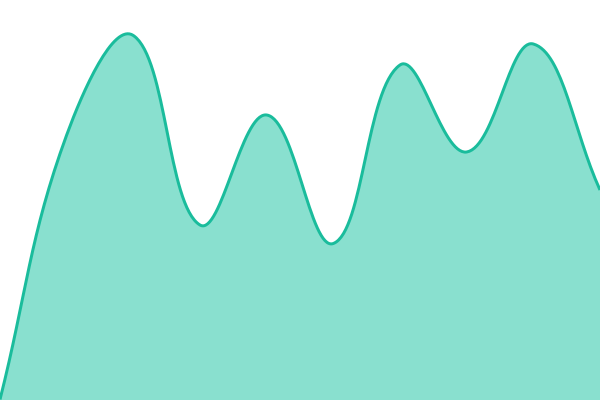
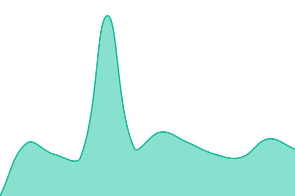

# [📈 Live Status](https://status.marvideo.is-a.dev): <!--live status--> **🟧 Partial outage**

This repository contains the open-source uptime monitor and status page for [Marcel](https://marvideo.fr), powered by [Upptime](https://github.com/upptime/upptime).

With [Upptime](https://upptime.js.org), you can get your own unlimited and free uptime monitor and status page, powered entirely by a GitHub repository. We use [Issues](https://github.com/Marvideo2009/upptime/issues) as incident reports, [Actions](https://github.com/Marvideo2009/upptime/actions) as uptime monitors, and [Pages](https://status.marvideo.is-a.dev) for the status page.

<!--start: status pages-->
<!-- This summary is generated by Upptime (https://github.com/upptime/upptime) -->
<!-- Do not edit this manually, your changes will be overwritten -->
<!-- prettier-ignore -->
| URL | Status | History | Response Time | Uptime |
| --- | ------ | ------- | ------------- | ------ |
|  [Main](https://marvideo.fr) | 🟩 Up | [main.yml](https://github.com/Marvideo2009/upptime/commits/HEAD/history/main.yml) | 

 1409ms
     
 | 

<a href="https://status.marvideo.fr/history/main">100.00%</a>
    

|  [Authentik](https://auth.marvideo.fr) | 🟩 Up | [authentik.yml](https://github.com/Marvideo2009/upptime/commits/HEAD/history/authentik.yml) | 

 1757ms
     
 | 

<a href="https://status.marvideo.fr/history/authentik">100.00%</a>
    

|  [Ntfy](https://ntfy.marvideo.fr) | 🟩 Up | [ntfy.yml](https://github.com/Marvideo2009/upptime/commits/HEAD/history/ntfy.yml) | 

 553ms
     
 | 

<a href="https://status.marvideo.fr/history/ntfy">100.00%</a>
    

|  [Matrix Server](https://chat.marvideo.fr) | 🟩 Up | [matrix-server.yml](https://github.com/Marvideo2009/upptime/commits/HEAD/history/matrix-server.yml) | 

 539ms
     
 | 

<a href="https://status.marvideo.fr/history/matrix-server">100.00%</a>
    

|  [S3 Server](https://s3.marvideo.fr) | 🟥 Down | [s3-server.yml](https://github.com/Marvideo2009/upptime/commits/HEAD/history/s3-server.yml) | 

 214ms
     
 | 

<a href="https://status.marvideo.fr/history/s3-server">29.07%</a>
    

|  [Git Server](https://git.marvideo.fr) | 🟩 Up | [git-server.yml](https://github.com/Marvideo2009/upptime/commits/HEAD/history/git-server.yml) | 

 672ms
     
 | 

<a href="https://status.marvideo.fr/history/git-server">100.00%</a>
    

|  [Img proxy Server](https://img.marvideo.fr) | 🟥 Down | [img-proxy-server.yml](https://github.com/Marvideo2009/upptime/commits/HEAD/history/img-proxy-server.yml) | 

 514ms
     
 | 

<a href="https://status.marvideo.fr/history/img-proxy-server">48.33%</a>
    

<!--end: status pages-->

[**Visit our status website →**](https://status.marvideo.is-a.dev)

## 📄 License

- Powered by: [Upptime](https://github.com/upptime/upptime)
- Code: [MIT](./LICENSE) © [Anand Chowdhary](https://anandchowdhary.com)
- Data in the `./history` directory: [Open Database License](https://opendatacommons.org/licenses/odbl/1-0/)
